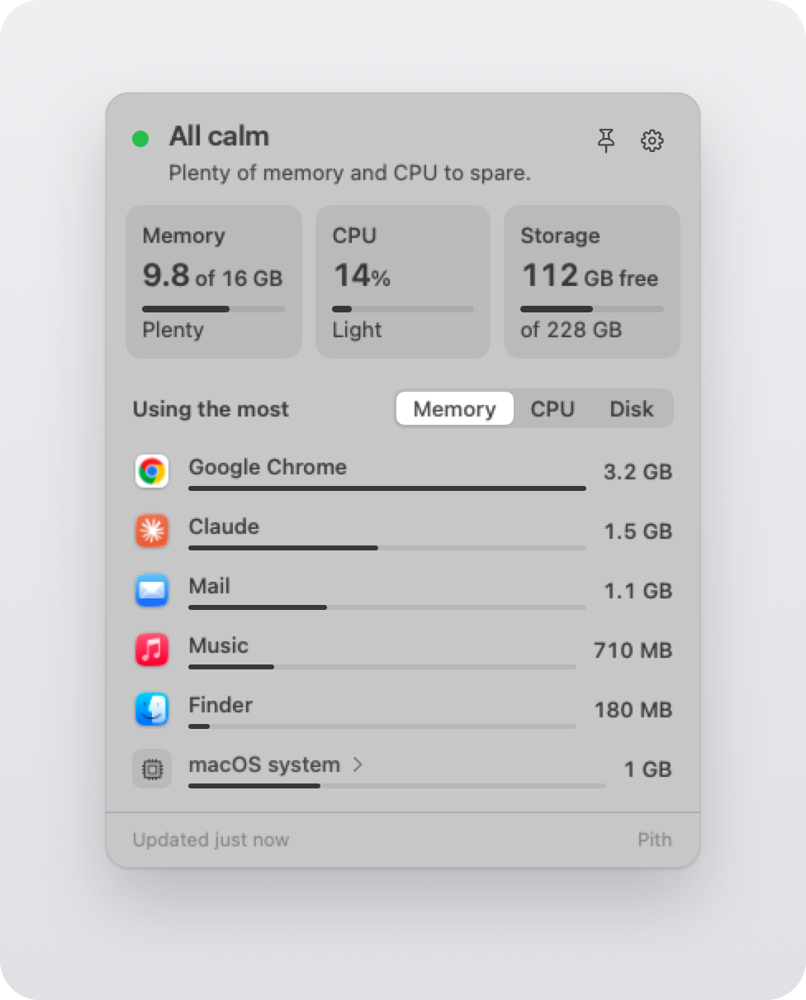
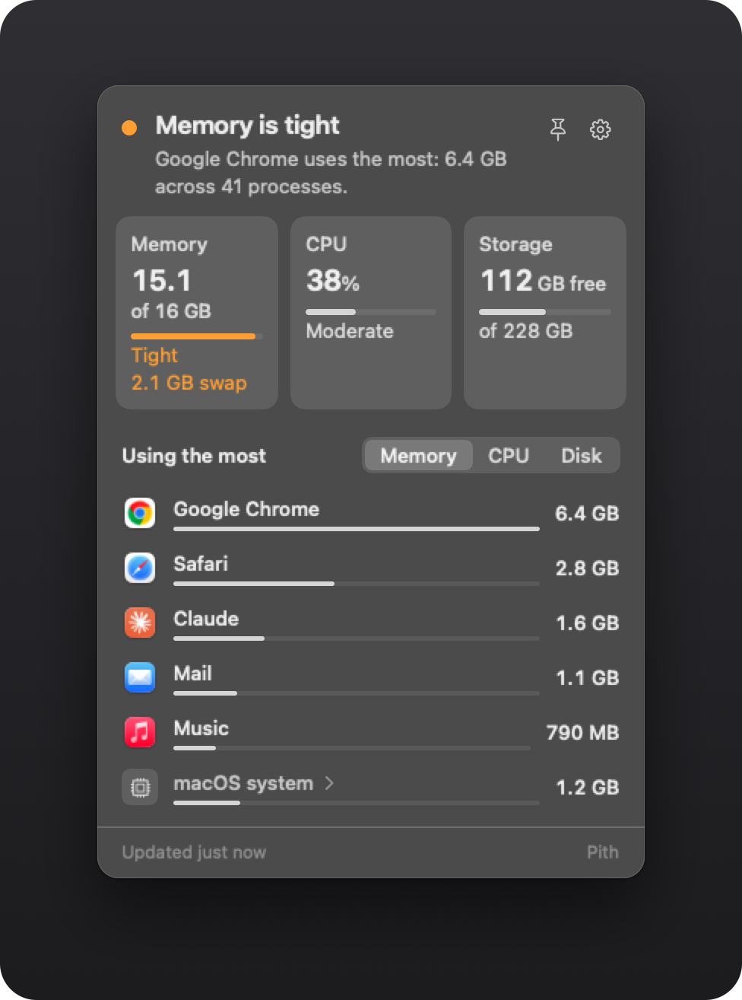

# Pith

What is using my Mac right now?

<p align="center">
  
</p>

Pith is a free, open-source menu-bar app for Apple Silicon Macs. A calm dot sits in the menu
bar. Click it, and one small panel shows memory, CPU and storage, and the apps that use the most.
Each app's helper processes count toward that app, in one row. Pith is light enough to leave
running all day, and its numbers are checked against `top`.

## What it shows

- **The dot.** An outline when all is calm. Amber when memory, CPU or storage is tight. Red when
  memory or storage is critical. No numbers in the menu bar.
- **One sentence** that says what matters now, for example "Google Chrome uses the most: 6.4 GB
  across 41 processes."
- **Three tiles:** memory in use and memory pressure, CPU load, and free space on the startup disk.
- **The apps that use the most**, by Memory, CPU or Disk. Open a row to see its helper processes
  grouped by role, a short explanation, and Quit.
- **macOS system**, always last: what macOS itself uses. Open it to see its largest parts.
- **Plain words** from a built-in guide of 187 checked entries. No AI.
- **Pin** keeps the panel floating while you work.

<p align="center">
  
</p>

<sub>Both images use Pith's synthetic demo data.</sub>

## Install

You need an Apple Silicon Mac with macOS 15 or later, and the Command Line Tools with Swift 6.
Xcode is not needed.

```bash
xcode-select --install        # only if the Command Line Tools are missing
git clone https://github.com/mrinoybanerjee/pith.git
cd pith
./scripts/build-app.sh        # builds and signs dist/Pith.app
mv dist/Pith.app /Applications/
open /Applications/Pith.app
```

To update, or when Pith is already in `/Applications`, run `git pull`, then
`./scripts/install.sh local`. It builds Pith, quits the running copy, replaces the app in
`/Applications` and opens it.

- Always open Pith from `/Applications`.
- On its first launch, Pith adds itself as a login item. Turn this off in Pith's Settings or in
  System Settings.
- The build signs Pith ad hoc. [docs/BUILDING.md](docs/BUILDING.md) explains a stable local
  signing identity, the tests and the install script.

## Privacy and safety

Pith reads:

- memory, memory pressure, swap, CPU load and free disk space, from macOS;
- for your own processes: the name, parent, path, memory footprint, CPU time and disk bytes read
  and written;
- app names and icons, from each app's bundle.

Of other users' processes, including macOS's own, Pith reads only the process IDs. macOS refuses
Pith the rest. Only Apple's `top` lists them, when you open "macOS system".

Pith never:

- **connects to the network.** No analytics, no accounts, no update checks;
- **installs a root helper** or asks for your password;
- **asks for a privacy permission;**
- **runs tools in the background.** The one tool it runs is Apple's `/usr/bin/top`: once, when you
  open "macOS system", and at most once every 10 s;
- **quits an app without asking.** Quit always asks first, and Pith never offers to quit part of
  macOS.

Pith saves only the settings you change, the pinned panel's position, and a note that it added
its login item.

## Speed

Each line is a release gate, measured with `scripts/perf.sh`.

| Measure | Budget | Mac mini M4 | MacBook Air M4 | MacBook Pro M5 Max |
|---|---|---|---|---|
| CPU, panel closed | ≤ 0.1% | 0.03% | <!-- fill: air --> | <!-- fill: pro --> |
| CPU, panel open | ≤ 1.5% | 1.09% | <!-- fill: air --> | <!-- fill: pro --> |
| Memory, panel closed | ≤ 30 MB | 21 MB | <!-- fill: air --> | <!-- fill: pro --> |
| Memory, panel open | ≤ 45 MB | 25 MB | <!-- fill: air --> | <!-- fill: pro --> |
| Wakeups per second, closed | ≤ 0.5 | 0.10 | <!-- fill: air --> | <!-- fill: pro --> |
| Wakeups per second, open | ≤ 2 | 0.52 | <!-- fill: air --> | <!-- fill: pro --> |
| Tools started | 0 | 0 | <!-- fill: air --> | <!-- fill: pro --> |
| One reading of all processes | ≤ 3 ms | 0.87 ms | <!-- fill: air --> | <!-- fill: pro --> |
| Launch to first reading | ≤ 300 ms | 125 ms | <!-- fill: air --> | <!-- fill: pro --> |
| Click to panel on screen | ≤ 100 ms | 55 ms | <!-- fill: air --> | <!-- fill: pro --> |
| macOS | 15 or later | 26.6.2 | <!-- fill: air --> | <!-- fill: pro --> |

CPU is the mean share of one core, as `top` shows it. "Open" is the default 2 s refresh. "Tools
started" leaves out the on-demand `top`. The Mac mini and the MacBook Air have 16 GB of memory;
the MacBook Pro has 128 GB.

## Accuracy

`scripts/accuracy.sh` compares Pith with `top`, for the same processes at the same moment, for
every app of 50 MB or more. CPU points are shares of the whole Mac.

| Check | Pass rule | Mac mini M4 | MacBook Air M4 | MacBook Pro M5 Max |
|---|---|---|---|---|
| Memory per app | within ±3% | pass, 2 of 2 runs | <!-- fill: air --> | <!-- fill: pro --> |
| CPU per app, over 10 s | within ±2 points | pass, largest gap 0.16 | <!-- fill: air --> | <!-- fill: pro --> |
| "macOS system" | never below zero | 100 of 100 readings | <!-- fill: air --> | <!-- fill: pro --> |

## More

- [docs/DESIGN.md](docs/DESIGN.md): what you see and how it behaves.
- [docs/BUILDING.md](docs/BUILDING.md): build, sign, test and install.
- [CHANGELOG.md](CHANGELOG.md): what changed in each version.

## Credits

Pith adapts a few system readers from [Stats](https://github.com/exelban/stats) by Serhiy
Mytrovtsiy, under the MIT License. [THIRD_PARTY_NOTICES.md](THIRD_PARTY_NOTICES.md) lists each
adapted file and keeps the Stats license.

## License

MIT. Copyright (c) 2026 Mrinoy Banerjee. See [LICENSE](LICENSE).
