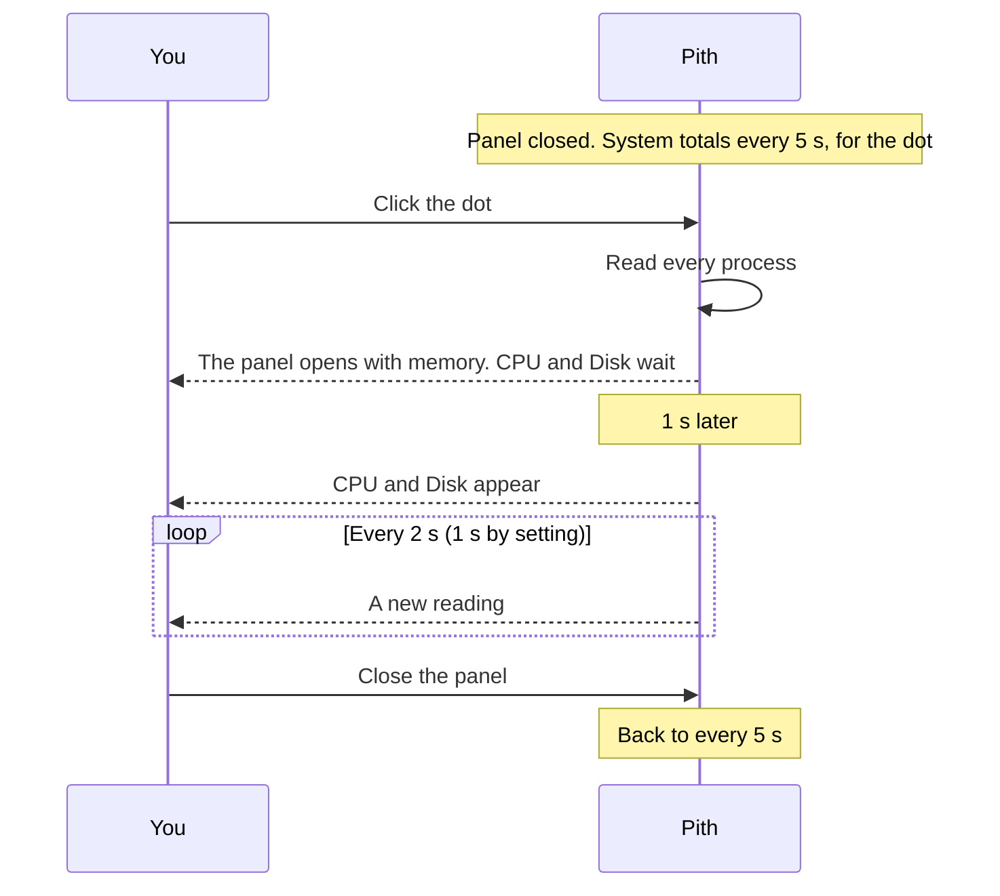
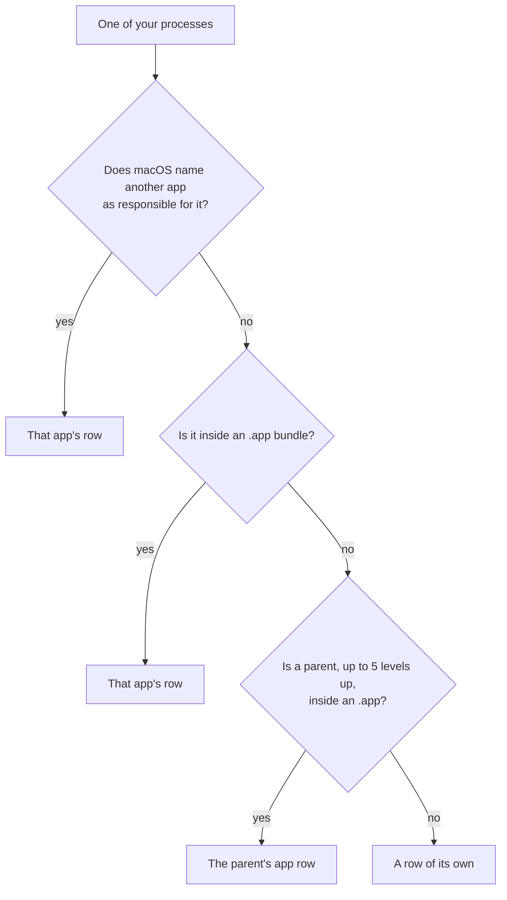
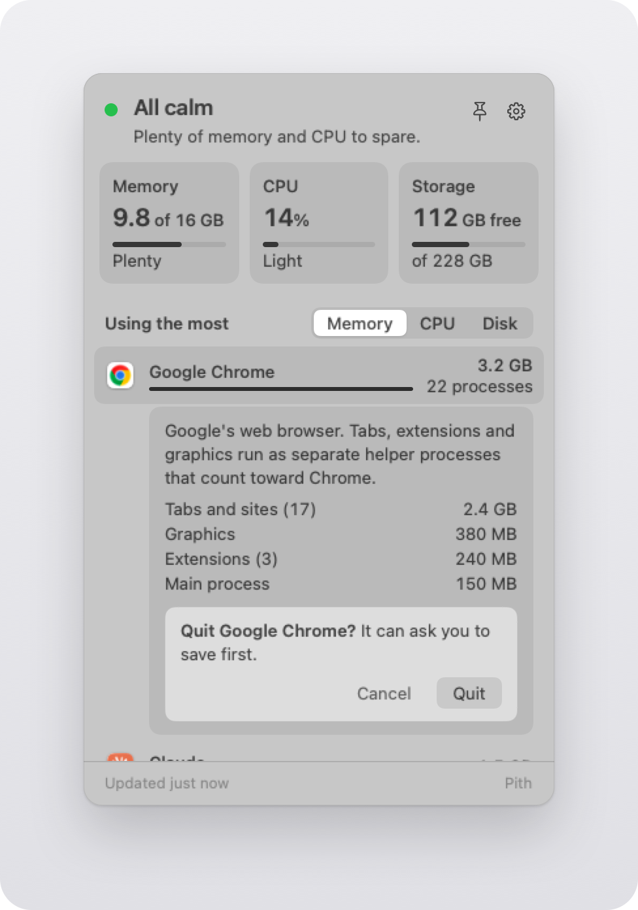
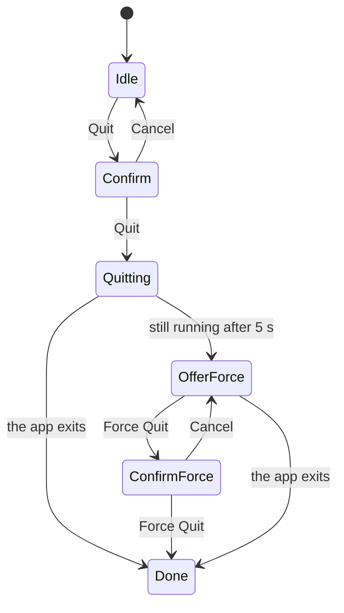

# Design

Pith answers one question at a glance: what is using my Mac right now? This page describes what
you see in Pith 0.1.0 and how it behaves. The full spec, with the architecture and the data
sources, is [specs/2026-10-25-pith-design.md](specs/2026-10-25-pith-design.md).

- **Quiet.** A dot in the menu bar, in color only when something is tight.
- **Plain words.** Apps and macOS processes have names that people use.
- **Honest numbers.** A value that Pith cannot measure shows "—", never 0.
- **Light.** One timer, no background tools, no network.

## The dot

The menu-bar item is a 16 pt image with a 9 pt circle, in a fixed 22 pt slot. The image changes
only when the state changes, never on a reading.

| State | Look | Enters when | Leaves when |
|---|---|---|---|
| Calm | Outline, in the menu bar's own color | No other state applies | — |
| Tight | Filled amber (system orange) | Memory pressure is *warning*, or CPU is at 80% or more for 60 s, or free space is under 10% of the startup disk | Every cause clears. CPU must stay under 70% for 60 s. |
| Critical | Filled red (system red) | Memory pressure is *critical*, or free space is under 5% of the startup disk | Every cause clears |

The setting "Dot turns amber on" can take CPU out of the Tight causes.

## The panel

  

- 360 pt wide. The height fits the content, up to 560 pt. A longer app list scrolls; the status
  line and the tiles stay in place.
- The popover material, with 14 pt corners, in light and dark.
- A click on the dot opens the panel under it. The panel appears only with a reading taken after
  the click, so it never shows old rows.
- It closes on a click outside, on Escape, or on a second click on the dot.
- It never takes focus from the app in front. It does take the keys for its shortcuts.

From top to bottom:

1. **Status line.** A 10 pt dot (green, amber or red), a 17 pt semibold title and a 13 pt
   sentence. Pin and Settings sit on the right.
2. **Three tiles.** Each has a caption, a value, a thin meter and a word.
   - **Memory:** "15.1 of 16 GB". The meter is used ÷ total. The word is Plenty, Tight or
     Critical, from memory pressure. Swap is added ("2.1 GB swap") when pressure is not normal or
     swap is over 1 GB.
   - **CPU:** "38%". The word is Light (under 30%), Moderate (30–70%) or Busy (over 70%).
   - **Storage:** "112 GB free", then "of 228 GB". The meter is the used share.
3. **"Using the most"**, with Memory · CPU · Disk. Memory is the default, and Pith remembers the
   choice across launches.
4. **App rows:** the top 8 by the chosen measure. Each has a 24 pt icon, the name over a 3 pt bar,
   and the value on the right.
5. **"macOS system"**, always last. See below.
6. **Awake bar:** "Keep awake" with 1 h, 4 h and ∞, or "Awake until 3:40 PM" with End. While a
   session runs, a thin ring circles the dot. See the
   [Awake spec](specs/2026-10-28-pith-awake.md).

### Status sentences

The first rule that applies sets the dot, the title and the sentence.

| When | Title | Sentence |
|---|---|---|
| Memory pressure is critical | Memory is very tight | "{App} uses the most: {memory} across {n} processes." |
| Free space is under 5% | Storage is almost full | "{free} free of {total}." |
| Memory pressure is warning | Memory is tight | "{App} uses the most: {memory} across {n} processes." |
| CPU is at 80% or more for 60 s | Your Mac is busy | "{App} is using {cpu} of the CPU." |
| Free space is under 10% | Storage is getting full | "{free} free of {total}." |
| Otherwise | All calm | "Plenty of memory and CPU to spare." |

### Numbers, type and color

- Memory uses binary units (1 GB = 2^30 bytes), as Activity Monitor and `top` do. Storage uses
  decimal units (1 GB = 10^9 bytes), as Finder does.
- App CPU is a share of the whole Mac, from 0 to 100%.
- A missing value shows "—". VoiceOver says "not available yet" for a first reading, and "not
  available" when Pith could not measure it; then the tooltip says "Pith couldn't measure this
  right now."
- SF Pro, 13 pt or larger for all text you read. All numbers use tabular digits.
- Native greys and materials. Amber and red appear only for Tight and Critical; the status-line
  dot is green when calm.

## When numbers arrive

- CPU and Disk are rates, so they need two readings. The first update after a click comes 1 s
  later, at either refresh setting.
- A pinned panel that other windows fully cover uses the closed speed.
- Low Power Mode, or a serious thermal state, doubles every interval.
- Readings stop on sleep, display sleep and screen lock, and start again on wake.

## Rows

### How processes become rows

Each app's helper processes count toward that app. Pith tries three ways, in this order:

- So a browser's tab, graphics and extension processes are one row, and `node` started from
  Terminal counts toward Terminal.
- A process outside any app shows its guide title, for example "Photos analysis" for
  `photoanalysisd`.
- If a macOS version lacks the "responsible process" call, Pith groups by the other two ways, and
  Settings says "App grouping is limited on this macOS version."

### An opened app row

Click a row, or press Return, to open it in place. It shows:

- "N processes" under the value, when there is more than one;
- the guide's explanation, when the guide knows the app;
- the app's processes, grouped by role, each with its count and memory. For example: "Tabs and
  sites (17) 2.4 GB", "Graphics 380 MB", "Extensions (3) 240 MB", "Main process 150 MB". A helper
  that no pattern matches shows its own name;
- **Quit**, when Pith may quit the app.

### The "macOS system" row

This row holds what your own processes leave unexplained: macOS itself, root and other users.

- **Memory** = the footprint total − the footprints of all your processes.
  - The footprint total is (internal − purgeable + wired + pages stored in the compressor) × the
    page size.
  - It counts a compressed page at its full size, as a process footprint does. So the two sides
    use the same basis.
  - The Memory tile still shows "used", as Activity Monitor defines it.
- **CPU** = the Mac's total CPU − the CPU of all your processes.
- **Disk** shows "not measured". macOS gives a normal app no disk counters for other users'
  processes.
- A result below zero shows "—" (an accounting mismatch), never a made-up number.

Open the row to see its largest parts:

1. Pith runs Apple's `/usr/bin/top` once and shows "Measuring…" for about a second.
2. The list shows the 4 largest system processes by memory, named by the guide (for example
   "Spotlight indexing"), then "Other system work", so that the lines add up to the row's total.
3. A note says "Measured once, just now. Pith asks macOS only when you open this."
4. Each process with a guide entry shows its explanation, and the row ends with "Part of macOS.
   Pith never offers to quit it."
5. Pith keeps the result for 10 s. If `top` fails, or takes more than 5 s, the row says
   "Couldn't measure system details" and offers Retry.

## Quit

  

1. **Quit** shows an inline confirm: "Quit {App}? It can ask you to save first." with Cancel and
   Quit.
2. **Quit** asks the app to quit normally, so it can ask you to save.
3. The row says "Quitting {App}…". If the app still runs after 5 s, the row offers **Force Quit**,
   with a second confirm: "Force Quit {App}? Unsaved changes will be lost."
4. Quit never shows for macOS processes, apps in `/System/Library`, other users' apps,
   command-line processes, or Pith itself.

Return presses a confirm's button only while you can see all of it. ↑, ↓ and Escape cancel a
confirm.

## Settings

Settings take the place of the tiles and the rows. There are exactly three:

| Setting | Options | Default |
|---|---|---|
| Launch at login | On / Off | On |
| Refresh while open | 1 s / 2 s | 2 s |
| Dot turns amber on | Memory, CPU or storage / Memory or storage only | Memory, CPU or storage |

- Pith saves a setting only when you change it. A setting that you never changed follows the
  default of each new version.
- Launch at login uses macOS login items. Pith turns it on once, at its first launch. After that,
  the switch shows what macOS says, and only you change it. If macOS refuses a change, Settings
  says so.
- 2 s is the default because it keeps the open panel inside its CPU budget. On the Mac mini, the
  open panel used 1.09% of one core at 2 s, and 1.9–2.4% at 1 s (budget 1.5%). The first update
  after a click still comes 1 s later.
- Below the settings: the limited-grouping notice when it applies, and a quiet **Quit Pith**. ⌘Q
  also quits Pith.

## Pin

The pin button turns the panel into a floating panel:

- it floats above other windows and never takes focus;
- it shows on every Space;
- you drag it by its background;
- it stays open while you work in other apps, and Escape does not close it.

Pith saves where you put it, keeps it on screen, and pins it there the next time. Unpinning
attaches the panel to the dot again and closes it.

## Motion and accessibility

- Rows move only when the rank really changes, with a 0.25 s ease. A value that changes by 2% or
  less never moves a row.
- With Reduce Motion, a crossfade replaces every movement.
- VoiceOver reads each row as one sentence: "{App}, {value} {measure}, {N} processes", then
  "collapsed" or "expanded". Each tile reads as one sentence.

| Key | Action |
|---|---|
| ↑ / ↓ | Move between rows |
| Return | Open or close a row |
| ⌘1 / ⌘2 / ⌘3 | Memory / CPU / Disk |
| Escape | Close the panel, when it is not pinned |
| ⌘Q | Quit Pith |

## The guide

Pith's plain words come from `guide.json`, inside the app. It has 187 checked entries:

| Kind | Entries | Example |
|---|---|---|
| Apps | 65 | Google Chrome: "Google's web browser. Tabs, extensions and graphics run as separate helper processes that count toward Chrome." |
| Helper patterns | 19 | `Helper (Renderer)` → "Tabs and sites" |
| macOS processes | 103 | `mds_stores` → "Spotlight indexing" |

- An entry matches exactly one of: a process name, a bundle ID, a path prefix or a helper pattern.
- Each macOS entry cites its source: a man page (97), an Apple Support page (2), or its file in an
  Apple framework (4).
- Tests check the format, that no two entries match the same thing, that each macOS entry has a
  source, and that no macOS entry can be quit.
- No AI writes or changes the text.
